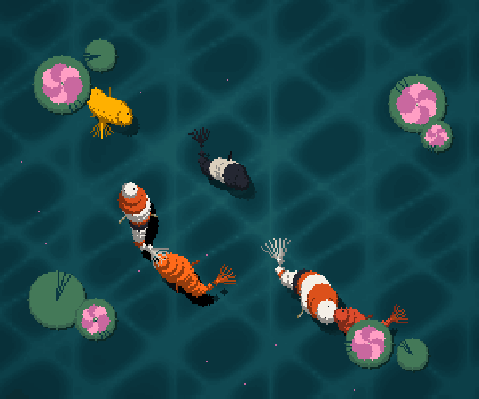
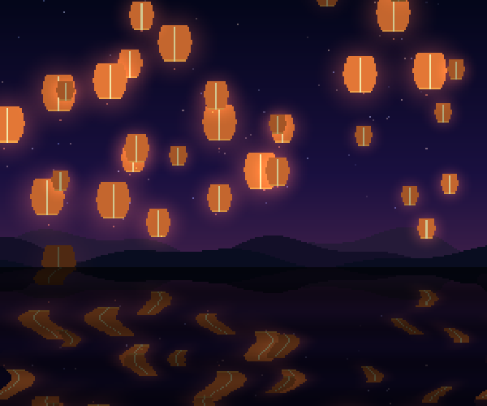
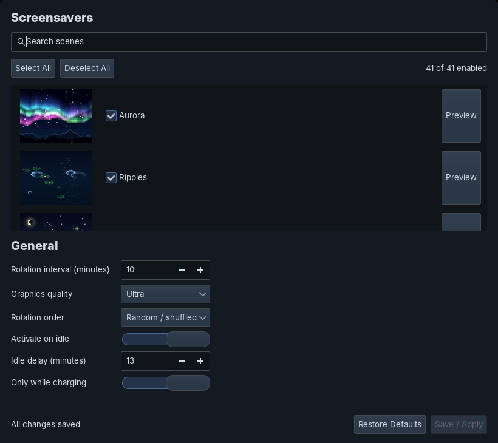

# fun

Little worlds for your Linux terminal. Pick a scene, or let `fun` wander through all 41 of them.



## Quick install

Open a terminal and paste these three commands:

```bash
git clone https://github.com/Slavro-1/fun.git
cd fun
./install.sh
```

Then start the screensaver:

```bash
fun
```

Press **Ctrl+C** to leave. Open the settings window with `fun-config`.

The first command downloads the project, the second enters its folder, and the third installs the commands. The installer may ask for your password through `sudo` to copy program files into `/usr/local`; it does not install system packages.

## A few places to drift

There are quiet scenes, bright ones, and a few surprises. `fun` changes scenes every 10 minutes by default. You can also choose a favorite with `fun --scene aurora` or see every available scene with `fun --list`.

<p align="center">
  
  
  <br><sub>Aurora · Stained glass</sub>
</p>
<p align="center">
  
  
  <br><sub>Jellyfish · Lanterns</sub>
</p>
<p align="center">
  
  
  <br><sub>Nebula · Silk</sub>
</p>

More motion, straight from the renderer:

<p align="center">
  
  
</p>

## Make it yours

Run `fun-config` to choose scenes, rotation order, quality, and idle behavior. It saves your choices for the next launch.

<p align="center"></p>

Useful shortcuts:

```bash
fun --scene koi       # stay with one scene; press q or Ctrl+C to leave
fun --list            # see all built-in scenes
fun --quality medium  # choose low, medium, high, or ultra
```

`fun-idle` can start a fullscreen screensaver after you step away. The installer adds a user autostart entry; run `fun-idle --diagnose` to check whether your desktop has a usable idle detector.

## Try it first, or download a ZIP

To try a scene from the downloaded folder without installing, run `./fun --scene aurora`. You can also run `./fun --list` to browse the names.

No Git? On this repository's GitHub page, choose **Code → Download ZIP**, extract it, open a terminal in the extracted `fun-main` folder, and run `bash install.sh`. Then use `fun` and `fun-config` as above.

## Requirements and terminal support

**For the screensavers:** Linux, Bash, Python 3.11 or newer, a UTF-8 terminal, and standard GNU/Linux command-line tools. The scene renderer uses the Python standard library. A truecolor terminal gives the best text-mode colors.

**Optional:** GTK4 and PyGObject for `fun-config`; Pillow adds thumbnails in that window. The idle watcher needs an idle detector available to your session. Some extra classic terminal programs are used only when installed.

`fun` uses kitty graphics automatically in a local kitty window. Other terminals use Unicode half-blocks; you can also force that mode with `FUN_GFX=0 fun --scene koi`. The project was developed and tested on Pop!_OS 24.04 with KDE Plasma and kitty. Other distributions have not been manually verified.

## If something goes wrong

- Run `fun --selftest` to check the built-in scenes. Launcher messages go to `~/.cache/fun/launcher.log`.
- If kitty graphics do not appear, try a local kitty window outside tmux or screen, or use `FUN_GFX=0 fun --scene koi`.
- If `fun-config` does not open, check GTK4, PyGObject, and that you are in a graphical session. Pillow is only needed for thumbnails.
- If idle startup does not work, run `fun-idle --diagnose`; idle detection and input access vary by session.
- If an interrupted scene leaves the terminal looking odd, run `reset`.

## Uninstall

From the downloaded project folder, run `./uninstall.sh` (or `bash uninstall.sh` from a ZIP). This removes installed program files and the desktop entries made by the installer. Saved settings, logs, and timestamped backups remain in your home directory.

## License

MIT. See [LICENSE](LICENSE).
