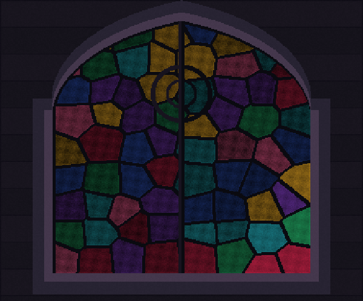
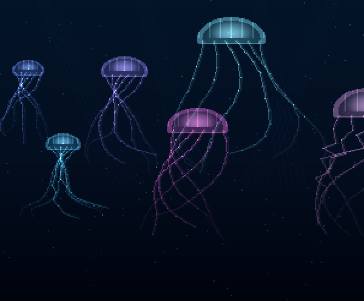

# fun

Little worlds for your Linux terminal. Pick a scene, or let `fun` wander through all 41 of them.


## Quick install

Open a terminal as your usual desktop user and run:

```bash
git clone https://github.com/Slavro-1/fun.git
cd fun
./install.sh
```

The installer lists which dependencies are present and which are missing. On Debian, Ubuntu, Pop!_OS, Fedora, and Arch Linux, it shows the package command and asks for your permission before running it. Enter `y` to approve or press **Enter** to skip a prompt. It uses `sudo` for approved package commands and to copy the program files into `/usr/local`, so you may be asked for your password.

The full installation needs system Python 3.11 or newer and GTK4 with PyGObject. If you skip a required package or the import still fails, setup stops before copying program files. Pillow adds thumbnails in the settings window, and kitty provides the graphics mode. You can skip either recommendation and finish setup.

After setup, start the screensaver:

```bash
fun
```

Press **Ctrl+C** to leave. Open the settings window with `fun-config`.

## A few places to drift

There are quiet scenes, bright ones, and a few surprises. `fun` changes scenes every 10 minutes by default. You can also choose a favorite with `fun --scene aurora` or see every available scene with `fun --list`.

<p align="center">
  
  
  <br><sub>Aurora · Stained glass</sub>
</p>
<p align="center">
  
  
  <br><sub>Jellyfish · Lanterns</sub>
</p>
<p align="center">
  
  
  <br><sub>Nebula · Silk</sub>
</p>

More motion, straight from the renderer:

<p align="center">
  
  
</p>

## Make it yours

Run `fun-config` to choose scenes, rotation order, quality, and idle behavior. It saves your choices for the next launch.

<p align="center"></p>

Useful shortcuts:

```bash
fun --scene koi       # stay with one scene; press q or Ctrl+C to leave
fun --list            # see all built-in scenes
fun --quality medium  # choose low, medium, high, or ultra
```

`fun-idle` can start a fullscreen screensaver after you step away. The installer adds a user autostart entry on first install. Run `fun-idle --diagnose` to check whether your desktop has a usable idle detector. The watcher uses kitty by default. To use another terminal, set `FUN_TERMINAL` in the watcher's desktop session environment. For example, if you have xterm, try the override with `FUN_TERMINAL='xterm -fullscreen -e /usr/local/bin/fun' fun-idle --now`.

## Try it first, or download a ZIP

To try a scene from the downloaded folder without installing, run `./fun --scene aurora`. You can also run `./fun --list` to browse the names.

No Git? On this repository's GitHub page, choose **Code → Download ZIP**, extract it, open a terminal in the extracted `fun-main` folder, and run `bash install.sh`. Then use `fun` and `fun-config` as above.

## Requirements and terminal support

**For the screensavers:** Linux, Bash, Python 3.11 or newer, a UTF-8 terminal, and standard GNU/Linux command-line tools. The scene renderer uses the Python standard library. A truecolor terminal gives the best text-mode colors.

**For the settings window:** GTK 4.8 or newer and PyGObject for `/usr/bin/python3`. Pillow for the same interpreter adds thumbnails. The installer probes that interpreter even if a virtual environment is active.

**For automatic idle start:** An idle detector available to your session and a terminal the watcher can launch. It can use readable input devices, GNOME's Mutter service via `gdbus`, `xprintidle` on X11, or `loginctl` on compatible sessions. Extra classic terminal programs are picked up when installed.

`fun` uses kitty graphics automatically in a local kitty window. Other terminals use Unicode half-blocks. You can also force that mode with `FUN_GFX=0 fun --scene koi`. The project was developed and tested on Pop!_OS 24.04 with KDE Plasma and kitty.

If you prefer to install dependencies yourself, use the packages for your distribution with its package manager, then rerun `./install.sh`.

| Distribution | Required packages for system Python and the GUI | Recommended packages |
| --- | --- | --- |
| Debian, Ubuntu, Pop!_OS (`apt`) | `python3 python3-gi gir1.2-gtk-4.0` | `python3-pil kitty` |
| Fedora (`dnf`) | `python3 python3-gobject gtk4` | `python3-pillow kitty` |
| Arch Linux (`pacman`) | `python python-gobject gtk4` | `python-pillow kitty` |

On other distributions, install system Python 3.11 or newer, PyGObject for that system Python, and the GTK 4.8 or newer runtime and introspection data. The installer prints commands to verify the imports. If APT reports missing indexes or download errors, run `sudo apt update` and retry.

## If something goes wrong

- Run `fun --selftest` to check the built-in scenes. Launcher messages go to `~/.cache/fun/launcher.log`.
- If kitty graphics do not appear, try a local kitty window outside tmux or screen, or use `FUN_GFX=0 fun --scene koi`.
- If `fun-config` does not open, run it from a terminal in your graphical session to see the error. Rerun `./install.sh` to check the GTK4 and PyGObject imports.
- If idle startup does not work, run `fun-idle --diagnose`; idle detection and input access vary by session.
- If an interrupted scene leaves the terminal looking odd, run `reset`.

## Uninstall

From the downloaded project folder, run `./uninstall.sh` (or `bash uninstall.sh` from a ZIP). This removes installed program files and desktop entries. It keeps saved settings, logs, and timestamped backups. System packages are managed separately by your distribution's package manager.

## License

MIT. See [LICENSE](LICENSE).
